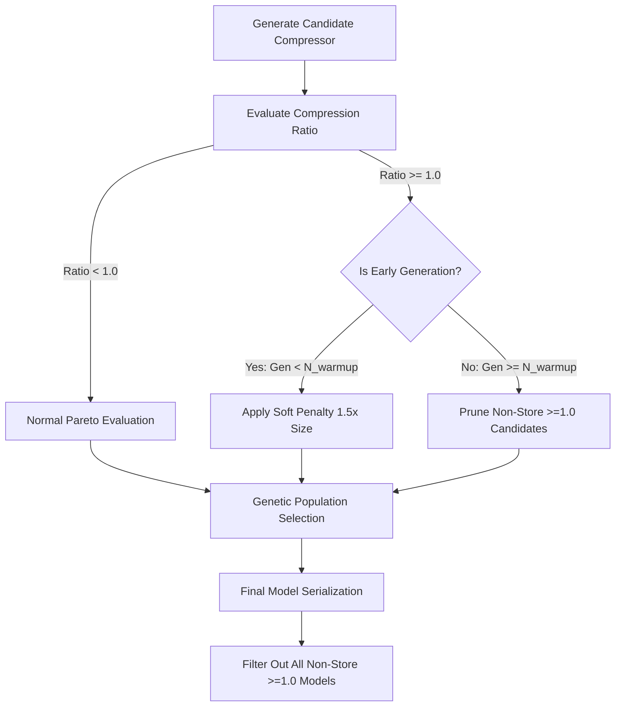

# Non-Compressing ($\ge 1.0$ Ratio) Candidate Handling in OpenZL Training

## Overview

During multi-objective genetic model training (`AutomatedCompressorExplorer` / `ACE`), candidate compression graphs are evaluated against a 3D Pareto fitness vector:

$$\text{Fitness} = (\text{compressedSize}, \; \text{compressionTime}, \; \text{decompressionTime})$$

In certain low-entropy attribute channels (e.g., `scan_angle_rank`), the genetic explorer often retains candidate graphs that achieve a compression ratio of $\ge 1.00$ (0% compression or net expansion). While some of these candidates exhibit ultra-high throughput (e.g. 2500+ MB/s), they are redundant in production because uncompressed `STORE` / `memcpy` dominates them in both implementation complexity and raw speed.

This document outlines the evolutionary rationale for keeping non-compressing candidates during early exploration, the drawbacks of unconstrained retention in late generations, and a proposed balanced strategy for future optimization.

---

## 1. Evolutionary Rationale (Why Keep $\ge 1.0$ Candidates Early?)

In genetic programming, candidates with a ratio $\ge 1.0$ (e.g., $1.01$–$1.05$) frequently act as **intermediate pre-conditioning building blocks**:

1. **Pre-conditioning & Structural Transforms**:
   Standalone pre-conditioners (such as `morton_3d`, `spherical_range`, `quars`, `bitplane_split`, `octree_occupancy`, or `tokenize`) re-order bytes, split streams, or build symbol dictionaries without compressing data on their own.
2. **Header & Metadata Overhead**:
   When evaluated in isolation before an entropy coder is attached, a pre-conditioner stage introduces minor header metadata, producing a net ratio slightly $> 1.00$ (e.g., $1,000\text{ raw bytes} \to 1,020\text{ bytes}$).
3. **Stepping-Stones to High Compression**:
   In generation $N+1$, when a crossover or mutation attaches an entropy stage (`pcodec`, `tans`, `zstd`, or `field_lz`) to that pre-conditioned stream, the compression ratio often drops dramatically from $1.02 \to 0.01$ (**100x compression**).
4. **Eager Pruning Risk**:
   If candidate pipelines with ratio $\ge 1.0$ are killed eagerly during early generations, the genetic explorer loses these unconditioned transform building blocks before they can pair with entropy coders in later generations.

---

## 2. Drawbacks of Unconstrained Retention

While non-compressing candidates are valuable in early generations, unconstrained retention throughout all generations causes two major issues:

- **Population Crowding**:
  In late generations, ratio $\ge 1.0$ candidates occupy active population slots, consuming evaluation bandwidth and crowding out actual compressing candidates.
- **Redundant Serialized Output Models**:
  In the final serialized model set (`.zlc`), candidate graphs with ratio $\ge 1.0$ are useless because `STORE` / `memcpy` strictly dominates them.

---

## 3. Recommended Hybrid Strategy

To achieve optimal exploration while keeping late generations and final outputs clean, the following hybrid policy is recommended for implementation:

### Proposed Changes

1. **Soft Fitness Penalty during Early Generations**:
   In `AutomatedCompressorExplorer::computeFitness`, candidates with `compressedSize >= uncompressedSize` receive a soft fitness penalty (e.g., $1.5\times$ size cost multiplier). This prevents them from dominating speed rankings while preserving them in the gene pool as potential mutation parents.

2. **Late-Generation Population Pruning**:
   After a warm-up phase (e.g., generation $> 10$), candidate selection in `AutomatedCompressorExplorer::reproduce` purges candidates with `compressedSize >= uncompressedSize` (except the basic `STORE` fallback) to focus search bandwidth on true compressing pipelines.

3. **Final Pareto Frontier Filtering**:
   In `filterParetoFrontier` / `combineCandidates` ([`tools/training/ace/ace_combination.cpp`](file:///home/tbirch/src/polez/innerloop/third-party/openzl/tools/training/ace/ace_combination.cpp#L223)), automatically filter out all candidate models with `compressedSize >= uncompressedSize` (retaining only `STORE` as the uncompressed fallback), ensuring the output `.zlc` directory contains only effective compressing models.
